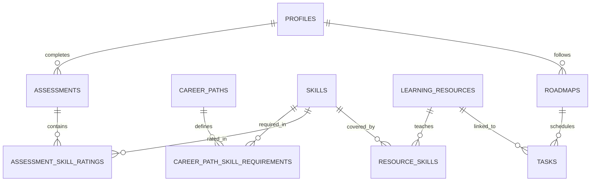

# 🚀 RotaMIS: Yapay Zekâ (AI) Modülü Devir Teslim ve Geliştirme Rehberi
**Doküman:** `AI_HANDOVER.md`  
**Proje:** RotaMIS — Yönetim Bilişim Sistemleri (YBS / MIS) Öğrencileri İçin Akıllı Kariyer Yol Haritası ve Asistanı  
**Tarih:** 27 Ekim 2026  
**Hedef Geliştirici:** AI & Yol Haritası Geliştiricisi (Yeni Takım Arkadaşımız)

---

## 👋 Hoş Geldin!
Merhaba! RotaMIS projesine hoş geldin. Bu doküman, projeyi GitHub'dan klonladığın andan itibaren kod tabanını, veritabanı mimarisini ve devralacağın **"Yapay Zekâ ile Dinamik Yol Haritası Üretimi"** ile **"AI Kariyer Chatbot'u"** görevlerini hızla ve keyifle hayata geçirmen için hazırlandı.

Bugüne kadar projenin tüm temel altyapısı (Landing Page, Auth akışı, Onboarding Check-Up, Öğrenci Dashboard'u ve Kapsamlı Admin Paneli) eksiksiz, güvenli ve yüksek performanslı şekilde inşa edildi. Artık RotaMIS'i "akıllı" kılan beyni seninle birlikte sisteme entegre edeceğiz!

---

## 1. Projenin Mevcut Durumu (Current Architecture & State)

### 🛠️ Teknoloji Yığını
- **Framework:** Next.js 16.4.2 (App Router, Turbopack, React 19)
- **Stil & Tasarım:** Tailwind CSS (Modern, dinamik, YBS ruhuna uygun Corporate Navy `#0B1F4D` ve Royal Blue `#2F5BFF` tema)
- **Veritabanı & Auth:** Supabase (PostgreSQL, Row Level Security - RLS, Database Triggers, PL/pgSQL RPC Fonksiyonları)
- **İkonlar & Bileşenler:** Lucide React, Radix UI temelleri, Sonner (Toast bildirimleri)
- **Grafikler:** Recharts (Beceri Radar Grafikleri)

### 📦 Bugüne Kadar Neler Tamamlandı?
1. **Landing Page (`/`):**
   - Samimi, dinamik, YBS öğrencilerine hitap eden açılış sayfası.
   - İnteraktif kariyer simülatörü, dinamik radar kartı, öğrenci yorumları ve tam SEO meta etiketleri.
2. **Kayıt & Giriş (Auth):**
   - `/register` ve `/login` akışı.
   - Geliştirme ortamında Supabase'in saatlik e-posta rate-limit'lerine takılmadan, `adminClient` ile arka planda anında onaylanan (`email_confirm: true`) ve tarayıcı çerezlerini hemen oluşturan sıfır sürtünmeli auth mimarisi.
3. **Onboarding (5 Dakikalık Beceri Check-Up):**
   - 5 adımlı sihirbaz: Üniversite seçimi, hedef kariyer alanı seçimi, teknik/iş/sosyal becerileri 1-5 seviyelerinde puanlama, çalışma temposu ve hedef belirleme.
4. **Öğrenci Paneli (`/dashboard`):**
   - Öğrencinin seçtiği kariyer alanı ile sektör beklentisini kıyaslayan canlı **Beceri Radarı (Skill Radar)**.
   - Sektör Hazırlık Skoru, En Büyük 3 Beceri Açığı kartları, XP, Seri (Streak) ve Rozet takibi.
   - Haftalık gelişim görev listesi (`tasks`).
5. **Admin Paneli (`/admin`):**
   - `role = 'admin'` olan kullanıcılara özel 5 katmanlı güvenlik duvarı.
   - **Sektör Beklenti Matrisi (`/admin/matrix`):** Hangi kariyer rolünün hangi beceriden kaçıncı seviye (1-5) ve hangi önem katsayısıyla (1-3) beklendiğini belirleyen atomik RPC destekli matris editörü ve ısı haritası.
   - **Katalog Yönetimi:** Kariyer Rotaları (`/admin/career-paths`), Beceri Havuzu (`/admin/skills`), Üniversiteler ve Liste Dışı Eşleştirme (`/admin/universities`), Öğrenme Kaynakları Kataloğu (`/admin/resources`).
   - **Öğrenci Yönetimi (`/admin/users`) & Audit Log (`/admin/audit`):** Değişiklik geçmişi ve öğrenci takibi.

### ⚡ Yeni Tamamlanan Performans İyileştirmeleri
- **React `cache()` Memoization:** `requireAdmin` çağrısı memoize edildi; tek bir request yaşam döngüsünde mükerrer DB ve auth çağrıları sıfıra indirildi.
- **Middleware Optimizasyonu:** `middleware.ts` içindeki ağır veritabanı sorgusu kaldırıldı. Middleware latensi **890ms'den 4ms'ye** düştü.
- **Paralel DB Sorguları (`Promise.all`):** Admin sayfalarındaki ardışık waterfall sorgular eşzamanlı hale getirildi (sayfa açılışları 1.5s $\rightarrow$ ~250ms).
- **Optimistic UI:** Yönetici sayfalarındaki silme, arşivleme ve güncelleme işlemleri yerel state üzerinden **0 ms** tepki süresiyle anında güncelleniyor.

---

## 2. Veri Mimarisi ve AI İçin Hayati Tablolar

AI modellerini beslerken doğrudan SQL yazmana gerek kalmayacak şekilde veritabanı seviyesinde hazır SQL görünümleri (View) oluşturulmuştur.



### 🎯 AI İçin En Kritik Tablo ve Görünümler

#### 1. `v_skill_gap` (SQL View - En Önemli Görünüm)
Öğrencinin hedeflediği kariyer rotası ile check-up'ta verdiği puanlar arasındaki açığı hazır matematiksel formülle (`required_level - student_level`) hesaplayan görünümdür.
```sql
SELECT 
  user_id,
  career_path_id,
  career_path_name,
  skill_id,
  skill_name_tr,
  skill_slug,
  category,        -- 'technical' | 'business' | 'soft'
  student_level,   -- Öğrencinin seviyesi (1-5)
  required_level,  -- Sektörün beklediği seviye (1-5)
  importance,      -- Beklentinin önemi (1: Normal, 2: Önemli, 3: Kritik)
  gap              -- required_level - student_level (Pozitifse açık var demektir)
FROM v_skill_gap
WHERE user_id = $1
ORDER BY gap DESC, importance DESC;
```
> **AI İçin Anlamı:** AI'a "öğrencinin neyi eksik?" diye hesaplatmana gerek yok. Bu view'dan `gap > 0` olan ilk 3-5 kaydı çektiğinde, öğrencinin odaklanması gereken öncelikli beceriler önüne hazır gelir.

#### 2. `learning_resources` (Onaylı Eğitim Kaynakları Kataloğu)
Admin panelinden eklenen, linkleri düzenli test edilen doğrulanmış eğitimler.
- `id`: UUID
- `title`: Kaynak başlığı (Örn: "Sıfırdan İleri Seviye SQL Eğitimi")
- `provider`: Sağlayıcı (BTK Akademi, Coursera, Udemy, YouTube, vb.)
- `url`: Doğrulanmış eğitim linki
- `resource_type`: 'course' | 'article' | 'video' | 'project' | 'certification' | 'practice'
- `language`: 'tr' | 'en' | 'mixed'
- `pricing`: 'free' | 'freemium' | 'paid'
- `estimated_hours`: Tahmini tamamlanma saati
- `difficulty`: 1 (Başlangıç) - 5 (İleri Düzey)
- `status`: 'published' | 'draft' | 'archived' (AI sadece `'published'` olanları kullanmalıdır!)

#### 3. `resource_skills` (Kaynak - Beceri Eşleştirme Tablosu)
Hangi kaynağın hangi becerinin hangi seviyelerini kapattığını belirtir:
- `resource_id`: `learning_resources.id`
- `skill_id`: `skills.id`
- `min_level`: Eğitime başlamak için gereken taban seviye (1-5)
- `target_level`: Eğitimi bitirince hedeflenen seviye (1-5)

#### 4. `roadmaps` & `tasks` (AI Çıktısının Kaydedileceği Hedef Tablolar)
- `roadmaps`: Öğrencinin aktif yol haritası (`user_id`, `career_path_id`, `title`, `summary`, `source: 'ai'`, `is_active: true`).
- `tasks`: Yol haritasına bağlı haftalık somut görevler.
  - `roadmap_id`: Bağlı olduğu yol haritası
  - `user_id`: Öğrenci ID
  - `title`: Görev başlığı (Örn: "SQL GROUP BY & JOIN Mantığını Kavra")
  - `description`: AI tarafından yazılmış pedagojik, motive edici yönerge
  - `week_number`: 1, 2, 3 veya 4
  - `difficulty`: 1-5
  - `estimated_minutes`: Görevin tahmini süresi (dk)
  - `xp_reward`: Tamamlandığında kazanılacak XP (Örn: 50, 100)
  - `resource_id`: `learning_resources.id` (Tıklayınca öğrenciyi doğrudan eğitime götürür)
  - `is_completed`: Görev tamamlandı mı? (default: false)

---

## 3. Yapay Zekâ (AI) Modülü Geliştirme Planı (Senin Görevin)

Geliştirmen gereken 2 ana modül bulunmaktadır:

---

### Görev A: Dinamik ve Kişiselleştirilmiş Yol Haritası (Roadmap) Üretimi

#### Mevcut Durum
Şu an öğrenci check-up'ı tamamladığında [`src/actions/onboarding.ts`](file:///c:/Users/hp/Desktop/rotam%C4%B1s/src/actions/onboarding.ts) dosyasındaki `generateInitialRoadmap` fonksiyonu çalışıyor. Bu fonksiyon şablon görevler üreten bir "Mock" fonksiyondur.

#### Beklenen Yeni AI Mimarisi
Mock fonksiyonunu gerçek bir LLM (Örn: Google Gemini 1.5 Pro / Flash) çağrısıyla değiştireceksin.

#### 🛡️ Kritik Kural: Sıfır Halüsinasyon (Anti-Hallucination) Prensibi
AI modelleri serbest bırakıldığında var olmayan kırık YouTube linkleri veya hayali kurslar uydurabilir. RotaMIS'te bunu engellemek için **"Context-Constrained Prompting"** uygulayacaksın:

1. **Adım 1 (Gap Tespiti):** `v_skill_gap` tablosundan öğrencinin `gap > 0` olan en kritik 3 becerisini çek.
2. **Adım 2 (Katalog Filtresi):** `learning_resources` tablosundan sadece bu 3 beceriyle eşleşen ve `status = 'published'` olan onaylı kaynakları çek.
3. **Adım 3 (LLM'e Sadece Bu Kaynakları Ver):** Prompt içerisine bu kaynakların ID, Başlık, Süre ve Hedef Seviyelerini JSON listesi olarak ver.
   > *"Sana aşağıda veritabanımızdaki doğrulanmış eğitim kaynaklarını veriyorum. ASLA bu liste dışından bir kaynak, link veya kurs uydurma. Görevlerde sadece verilen `resource_id` değerlerini kullan."*
4. **Adım 4 (Structured JSON Çıktısı):** LLM'den yanıtı doğrudan TypeScript şemamıza uygun JSON formatında al (`response_format: { type: "json_object" }`).

#### İdeal JSON Çıktı Şeması
```json
{
  "roadmap_title": "4 Haftalık İş Analisti Hızlandırma Planı",
  "roadmap_summary": "Check-up sonuçlarına göre SQL ve Süreç Modelleme alanındaki eksiklerini kapatarak sektöre hazır hale gelmen için tasarlandı.",
  "weeks": [
    {
      "week_number": 1,
      "focus_area": "Veri Sorgulama Temelleri",
      "tasks": [
        {
          "title": "İlişkisel Veritabanı ve SELECT Sorguları",
          "description": "Temel veri tabanı mimarisini kavra ve filtreleme alıştırmalarını tamamla.",
          "resource_id": "97fb2203-ee5a-4637-b6a5-a4039accdb0e", // Veritabanındaki gerçek ID
          "estimated_minutes": 180,
          "difficulty": 2,
          "xp_reward": 50
        }
      ]
    }
  ]
}
```

5. **Adım 5 (Veritabanına Yazma):**
   - Üretilen JSON'ı `adminClient` kullanarak `roadmaps` tablosuna `source: 'ai'` olarak kaydet.
   - Görevleri `tasks` tablosuna `resource_id` referansıyla `bulk insert` et.
   - Kullanıcı `/dashboard` sayfasına yönlendiğinde yeni görevlerini hemen görsün.

---

### Görev B: AI Kariyer Asistanı (Chatbot Modülü)

#### Vizyon & Amaç
YBS öğrencileri genellikle "Hangi alana yönelmeliyim?", "Mülakatta bu rolden ne sorarlar?", "CV'me bu projeyi nasıl yazmalıyım?" gibi konularda mentora ihtiyaç duyar. Öğrenci paneline entegre edilecek interaktif bir **"RotaMIS AI Asistanı"** oluşturacaksın.

#### Teknik Mimari ve RAG (Retrieval-Augmented Generation)

1. **Arayüz Konumu:**
   - Seçenek 1: `/dashboard` sayfasının sağ altına şık, açılır kapanır bir Floating Widget (`<AIChatDrawer />`).
   - Seçenek 2: Sol menüye yeni bir `/assistant` sayfası.
   - *(Tasarım dili: Corporate Navy `#0B1F4D` ve Royal Blue `#2F5BFF`, Lucide ikonlar, akıcı sohbet balonları).*

2. **Dinamik Öğrenci Bağlam Kartı (Student Context Card):**
   Öğrenci bota her mesaj attığında, arka planda öğrencinin güncel profili prompt'a `System Message` olarak gizlice enjekte edilir:
   ```markdown
   Sistem Rolü: Sen RotaMIS platformunun uzman Yönetim Bilişim Sistemleri (YBS / MIS) Kariyer Danışmanısın.
   Karşındaki Öğrencinin Güncel Bilgileri:
   - Adı: Ahmet Yılmaz
   - Üniversite: Marmara Üniversitesi (3. Sınıf)
   - Hedef Kariyer Alanı: Veri Analisti (Data Analyst)
   - Güncel Beceri Puanları (1-5): SQL: 2, Python: 2, PowerBI: 1, İletişim: 4
   - En Kritik 3 Açığı (Gap): PowerBI (Açık: 3 Seviye), SQL (Açık: 2 Seviye)
   - Bu Haftaki Aktif Görevi: "SQL JOIN ve Alt Sorgular Alıştırması"
   
   Davranış Kuralları:
   - Cevaplarında öğrencinin hedefi olan "Veri Analisti" rolü ile YBS disiplinini harmanla.
   - Ezbere genel cevaplar verme; öğrencinin puanlarına ve açıklarına doğrudan atıfta bulunarak somut, motive edici ve taktiksel rehberlik yap.
   - Gerektiğinde mülakat simülasyonu yap ("Bana SQL'deki LEFT JOIN ile INNER JOIN farkını açıklar mısın Ahmet?").
   ```

3. **Streaming Yanıtlar (Gerçek Zamanlı Yazma Efekti):**
   - Next.js 16 Server Actions veya Route Handlers (`ReadableStream`) kullanarak botun yanıtını harf harf akıtarak (streaming) son derece modern bir kullanıcı deneyimi sun.
   - `@ai-sdk/react` (Vercel AI SDK) veya doğrudan Google Gemini Stream API kullanabilirsin.

---

## 4. Kurulum ve Başlangıç Adımları

Projeyi kendi bilgisayarına kurmak için şu adımları izle:

### 1. Depoyu Klonla ve Bağımlılıkları Yükle
```bash
git clone <repo-url>
cd rotamis
npm install
```

### 2. Ortam Değişkenlerini (`.env.local`) Yapılandır
Proje ana dizininde `.env.local` dosyasını oluştur veya güncelle:
```env
# Supabase Bağlantısı
NEXT_PUBLIC_SUPABASE_URL=https://cdawflacnlqakkaojsho.supabase.co
NEXT_PUBLIC_SUPABASE_ANON_KEY=eyJh... (Takım liderinden temin ediniz)
SUPABASE_SERVICE_ROLE_KEY=eyJh... (Admin işlemleri için gizli anahtar)

# AI Sağlayıcı Anahtarı (Gemini / OpenAI)
GEMINI_API_KEY=AIzaSy... (Google AI Studio'dan temin ediniz)
```

### 3. Geliştirme Sunucusunu Başlat
```bash
npm run dev
```
Uygulama `http://localhost:3000` adresinde çalışacaktır.

### 4. Test Kullanıcıları
Veritabanında halihazırda test edebileceğin hesaplar:
- **Admin Hesabı:** `cetin.cenes05@gmail.com` (Yetki: `role = 'admin'`. `/admin` rotasını test etmek için.)
- **Öğrenci Hesabı:** `enescursor1@gmail.com` (Onboarding'i bekleyen test öğrencisi.)

---

## 5. Kritik Geliştirici İpuçları & Kurallar

1. **Admin İşlemleri İçin:**
   - AI arka plan görevlerini veya toplu yol haritası eklemelerini yaparken `src/lib/supabase/admin.ts` içindeki `createAdminClient()` fonksiyonunu kullan (RLS kısıtlamalarına takılmadan `tasks` ve `roadmaps` yazabilirsin).
2. **İstemci (Client) Tarafında Güvenlik:**
   - `createAdminClient()` ve `SUPABASE_SERVICE_ROLE_KEY` asla `"use client"` bileşenlerine aktarılmamalıdır. Sadece Server Actions (`"use server"`) veya API Route'larında çalıştırılmalıdır.
3. **Mevcut Tasarım Sistemi:**
   - Renk paletinde kurumsal mavimiz `#0B1F4D` ve canlı etkileşim mavimiz `#2F5BFF` kullanılıyor. Yeni bir arayüz eklerken bu paleti ve Tailwind `rounded-2xl`, `rounded-3xl` formlarını korumaya özen göster.
4. **Lint & Build Testi:**
   - Kodunu commit'lemeden önce `npm run build` çalıştırarak TypeScript tip hatalarını kontrol et. Projede tip katılığı çok yüksektir.

---

**Başarılar dileriz! RotaMIS'i yapay zekâ ile geleceğe taşıyacak harika işler çıkaracağına eminiz. Sorun olursa repo issue'larından veya Slack/Discord üzerinden dilediğin zaman ulaşabilirsin!** 🚀
